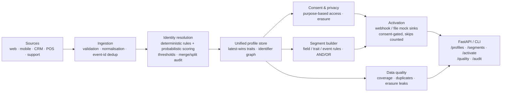

# Customer Data Platform

**One customer, many fragments — stitched into a single governed profile: multi-source ingestion → deterministic + probabilistic identity resolution with an audit trail → a unified profile store where consent and erasure are enforced, not documented → segments that activate only to people who said yes.**

`topic: data-engineering` · Python 3.11+ · stdlib-only core · FastAPI service surface

All data is **synthetic** (invented people, emails and events) and all
code is original — a clean-room build with a generic domain, suitable
for studying the architecture without any real-world system behind it.

---

## The enterprise problem

A customer shows up as an anonymous cookie on the website, an email
at signup, a phone number at the till, and a CRM record with a
different spelling of their name. Downstream, marketing emails the
same person three times, analytics counts them as three customers,
and — worst — a deletion request deletes one fragment and leaves the
other two live.

A Customer Data Platform fixes that only if it is more than an event
pipe:

1. **Identity must be explainable.** Every stitch needs a reason —
   shared email, or a scored probabilistic match — and merges must be
   auditable and reversible, because a wrong merge is worse than a
   duplicate.
2. **Consent must be enforced at use, not stored and forgotten.** A
   segment activated for marketing must skip people who never granted
   marketing consent, and the skip must be counted, not silent.
3. **Erasure must be total.** Deleting a profile means wiping every
   identifier and trait, leaving only a tombstone so downstream
   systems can honour the deletion — and a quality check must prove
   no PII survived.
4. **Ingestion must survive retries.** Sources redeliver; event-id
   deduplication means a retry never double-counts a customer.

This platform is those pieces as one small, runnable system.

## Architecture



Full detail, decisions and failure-mode analysis: **[docs/architecture.md](docs/architecture.md)**.

## What it demonstrates

| Capability | Where |
|---|---|
| Multi-source ingestion with validation, email/phone normalisation and event-id deduplication | `ingestion.py`, `models.py` |
| Deterministic identity rules on strong identifiers (user_id, email, phone) | `identity.py` |
| Probabilistic scoring (name similarity, city, device, anonymous id) with auto-link and review thresholds | `identity.py` |
| Merge / split with a full audit log; weak matches create a new profile instead of a risky merge | `identity.py`, `profiles.py` |
| Unified profile store: identifiers accumulate, descriptive fields are latest-wins by observation time | `profiles.py` |
| Consent per profile per purpose; purpose-based access with transactional-by-default semantics | `consent.py` |
| Erasure that wipes all PII and leaves an audited tombstone | `profiles.py`, `consent.py` |
| Segment builder over fields, traits and event history with AND/OR combinators | `segments.py` |
| Consent-gated activation to webhook/file mock sinks, with skipped-no-consent counts | `activation.py` |
| Data quality checks: email coverage, duplicate emails, orphan events, erasure leaks, identifier completeness | `quality.py` |
| FastAPI surface + CLI over a framework-free service layer | `service.py`, `cli.py` |

## Quick start

```bash
pip install -r requirements.txt
pip install -e .

# Run the test suite
PYTHONPATH=src python -m pytest -q

# End-to-end offline demo: stitch one person from web + mobile + CRM,
# gate a marketing activation on consent, erase a profile, run quality
python examples/run_demo.py
# equivalently: customer-data-platform demo
```

Run the service:

```bash
pip install -e ".[api]"
customer-data-platform serve --port 8000
curl localhost:8000/profiles
curl -X POST localhost:8000/fragments -H 'content-type: application/json' \
  -d '{"fragment_id":"f1","source":"web","observed_at":1700000000,"email":"a@b.com"}'
curl -X POST localhost:8000/consent -H 'content-type: application/json' \
  -d '{"profile_id":"<id>","purpose":"marketing","status":"granted"}'
curl localhost:8000/quality
curl localhost:8000/audit
```

Or with Docker: `docker build -t customer-data-platform . && docker run -p 8000:8000 customer-data-platform`

## Design decisions & trade-offs

* **Deterministic first, probabilistic second — and probabilistic is
  conservative.** A shared strong identifier always wins. A scored
  match auto-links only above 0.85; between 0.60 and 0.85 it is
  logged for review and a *new* profile is created. *Trade-off:* more
  duplicates than an aggressive matcher — chosen deliberately, because
  a wrong merge leaks one person's data into another's profile, while
  a duplicate is a quality metric.
* **Merges are audited and splits are first-class.** Every merge,
  split, link and erasure writes an audit entry with actor and
  reason. Identity graphs in production *will* need undoing; the
  audit log is what makes that possible.
* **Consent is checked at activation, with the segment's purpose.**
  Storing consent is not enforcement. The activator filters members
  through the consent manager for the segment's declared purpose and
  reports how many were skipped. *Trade-off:* an audience count is
  always "members" vs "deliverable", never one ambiguous number.
* **UNKNOWN consent denies — except transactional.** Marketing,
  analytics and personalisation require an explicit grant. Order
  confirmations (transactional) are permitted unless explicitly
  denied, matching contract-necessity practice.
* **Erasure leaves a tombstone, not a void.** Identifiers, names and
  traits are wiped, but the profile shell remains marked erased so
  downstream consumers can propagate deletion and the erasure-leak
  quality check has something to verify against.

## Repository layout

```
src/customer_data_platform/
  models.py       Typed domain models + identifier normalisation
  ingestion.py    Multi-source ingestion: validation, dedup, reports
  identity.py     Deterministic + probabilistic resolution, merge/split, audit
  profiles.py     Unified profile store (latest-wins, erasure)
  consent.py      Per-purpose consent + purpose-based access enforcement
  segments.py     Rule-based segment builder (fields, traits, events)
  activation.py   Consent-gated activation: webhook + file mock sinks
  quality.py      Data quality checks over the profile store
  service.py      Framework-free service + FastAPI app factory (guarded import)
  cli.py          customer-data-platform CLI (demo / profiles / quality / serve)
  demo.py         End-to-end demo scenario over synthetic data
tests/            pytest across ingestion, identity, consent, segments, activation, quality, service
docs/             Architecture deep-dive + CI template
examples/         run_demo.py
```

## Roadmap

- [ ] Streaming ingestion (Kafka/Kinesis seam) behind the ingestor
- [ ] Graph-based identity store with transitive stitching across devices
- [ ] Consent receipts and jurisdiction policies (GDPR/CCPA variants)
- [ ] Real sinks (warehouse reverse-ETL, ad platforms) behind the sink interface
- [ ] Profile export (DSAR) bundles generated from the tombstone + audit log

## License

MIT — see [LICENSE](LICENSE).
